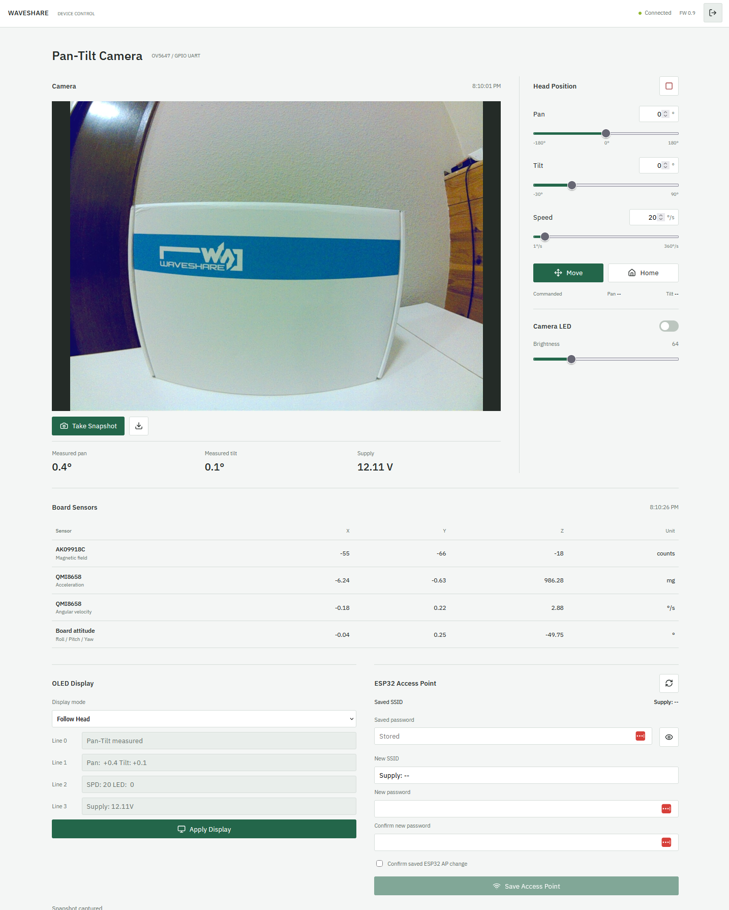

# Waveshare Pan-Tilt Tools

## Quickstart

CLI, Python API and optional web controls for the Waveshare 2-Axis Pan-Tilt Camera
Module and General Driver for Robots board. The ESP32 controls the servos, OLED
and camera LED; the Raspberry Pi controls the OV5647 CSI camera.

These instructions target a **Raspberry Pi 5 running Raspberry Pi OS Trixie
(64-bit)** with Python 3.13 or newer. Raspberry Pi OS Lite works for SSH, photos,
video and web controls; camera preview requires a local graphical session.

### Prerequisites

Before starting, assemble the pan-tilt module and configure its servo IDs according
to the [Waveshare assembly instructions](https://www.waveshare.com/wiki/2-Axis_Pan-Tilt_Camera_Module):
**pan ID 2** and **tilt ID 1**. The driver board must be running **PT firmware
v0.9**. The Pi configuration script does not configure servo IDs or flash firmware.

### 1. Prepare Raspberry Pi OS

Use [Raspberry Pi Imager](https://www.raspberrypi.com/software/) to install the OS.
Set a username, password and network connection, and enable SSH if using the Pi
without a monitor. Boot the Pi, sign in, and install the dependencies:

```bash
sudo apt update
sudo apt full-upgrade -y
sudo apt install -y git python3-venv python3-pip python3-picamera2 \
    python3-libcamera python3-numpy python3-pil rpicam-apps raspi-config
```

Picamera2, libcamera, NumPy and Pillow must come from the OS packages. The virtual
environment below uses `--system-site-packages` to access them. Do not install
replacement camera bindings or NumPy with pip. The CLI's only pip dependency is
pyserial; Flask and Waitress are optional web dependencies.

### 2. Clone And Configure The Pi

Clone the repository and preview the required settings:

```bash
git clone https://github.com/ferzkopp/WS-PanTilt.git
cd WS-PanTilt
sudo python3 configure_pi.py --user "$USER" --dry-run
```

Review the preview, then apply:

```bash
sudo python3 configure_pi.py --user "$USER" --apply
```

The [configuration script](configure_pi.py) uses the OS's noninteractive
`raspi-config` commands to disable the serial login console, enable GPIO UART0
(`dtparam=uart0=on`) and enable camera auto-detection. It adds your login user to
`dialout` and `video` without replacing existing group memberships.

The default is preview-only; even preview requires sudo because `raspi-config`
requires root for its queries. Without `--user`, the script uses the sudo caller;
when running directly as root, explicitly select a non-root login account.

Before applying, it backs up both boot files under `/var/backups/pantilt/` and
prints the backup location. Repeated runs skip settings and memberships that
already match, without creating another backup. Changes are verified afterward;
on failure, backups remain available, but changes are not automatically rolled
back. The script never reboots, powers off, installs packages or sends hardware
commands.

The script targets standard Raspberry Pi OS Trixie (64-bit) on Pi 5. Custom boot
includes, alternate boot paths, conditional or duplicate UART/camera settings,
combined UART parameters, and boot configs not ending in `[all]` are refused
before changes; configure those manually instead.

If the script applied changes, reboot and sign in again to activate the boot
settings and new group memberships:

```bash
sudo reboot
```

If the script reports that everything is already configured and those settings
are active, no reboot is needed. There is no need to power down or reconnect an
already assembled and connected module just to configure the Pi.

#### Wiring Reference (Only If Needed)

Skip this section if the module and camera are already connected. Before adding
or changing GPIO or CSI connections, shut down the Pi with `sudo poweroff` and
disconnect power from both devices. Connect the OV5647 camera to a Pi CSI
connector using a Pi 5-compatible camera cable. The board UART connections are:

| Raspberry Pi 5 GPIO header | Driver board |
| --- | --- |
| GPIO14 / TXD, physical pin 8 | RX |
| GPIO15 / RXD, physical pin 10 | TX |
| GND, for example physical pin 6 | GND |

Use 3.3 V UART logic, not RS-232 levels. Follow the
[Waveshare wiring and power instructions](https://www.waveshare.com/wiki/2-Axis_Pan-Tilt_Camera_Module)
for the board's power supply. Clear the head's travel path before powering on.
After changing connections, restore power and sign in again.

The GPIO UART is `/dev/ttyAMA0`, at 115200 baud, 8N1. On Pi 5, `/dev/serial0` may
point to the separate debug UART (`ttyAMA10`); do not assume it is the GPIO UART.

### 3. Install And Validate

After any required reboot and fresh login, return to the cloned repository
directory and create the environment as your normal user:

```bash
cd WS-PanTilt
python3 -m venv --system-site-packages .venv
source .venv/bin/activate
python -m pip install -e .

pantilt doctor
pantilt feedback --seconds 3
```

`doctor` should report `port_exists: true`, `port_accessible: true`, a path for
`rpicam_vid`, and a nonempty `cameras` list identifying the OV5647. Its `summary`
is `All OK` when all checks pass, or `Checks failed` with a nonzero exit status
otherwise. There is no need to run `camera list` separately. `feedback` should
return a JSON reply from the board: `doctor` checks device access and camera
discovery, not UART communication, so a feedback reply validates that connection
separately.

If validation fails:

| Symptom | Check |
| --- | --- |
| UART missing | Confirm `dtparam=uart0=on` is active and reboot. |
| UART permission denied | Run `id -nG`; confirm `dialout` membership after a fresh login. |
| No board reply | Check board power, crossed TX/RX, common ground, serial console settings and that no other process owns the UART. |
| Missing camera bindings | Activate the environment created with `--system-site-packages`; use the OS packages above. |
| Empty camera list | Power off before reseating the CSI cable; check its orientation, connector and `camera_auto_detect=1`. |
| Missing `rpicam_vid` | Install `rpicam-apps` and check `command -v rpicam-vid`. |

For a different UART, use `pantilt --port /dev/DEVICE doctor` or set
`PANTILT_PORT`. Global options go **before** the subcommand. Run `pantilt` as your
normal user, not with sudo.

### 4. Use The Tooling

Start with a dry run, then a small movement. Pan is positive to the right; tilt is
positive upward. Keep cables and obstacles clear. **Speed 0 means maximum speed,
not stop**; use `pantilt stop` to stop movement.

```bash
pantilt --dry-run move 10 5 --speed 20
pantilt move 10 5 --speed 20
pantilt home
pantilt stop
pantilt oled 0 "Camera ready"
pantilt sensors

mkdir -p ~/Pictures ~/Videos
pantilt camera photo ~/Pictures/camera.jpg
pantilt camera video ~/Videos/camera.mp4 --seconds 10
```

To use the optional browser controls, install the web extra and start the server:

```bash
python -m pip install -e '.[web]'
pantilt web --host 0.0.0.0 --port 8080
```

On some Raspberry Pi OS images, pip reports that `types-flask-migrate` requires
`Flask-SQLAlchemy`, even though installation succeeds. This unrelated typing
package is inherited through `--system-site-packages`. The tools do not use it;
to satisfy that dependency in your virtual environment, run
`python -m pip install 'Flask-SQLAlchemy>=3.0.1,<4'` without sudo. Do not remove
system packages or replace the native camera stack to address this warning.

Open `http://PI_ADDRESS:8080` from the same **trusted LAN**, replacing
`PI_ADDRESS` with the Pi's hostname or IP address. The server prints the login
password to the console at startup and saves it in `~/.config/pantilt/web-password`.
Keep console output private; redirected output or service logs will contain the
password too.

HTTP is not encrypted. Do not expose this port to the internet; see
[Web Interface](#web-interface) for an SSH tunnel. Stop the server with Ctrl+C
before using board CLI commands: only one process should own the UART. Nothing
starts automatically at boot.

For subsequent terminal sessions, run `cd WS-PanTilt` from its parent directory
and `source .venv/bin/activate`. Use `pantilt --help` or `pantilt COMMAND --help`
for command options.

## CLI Reference

Additional commands:

```bash
pantilt move 30 10 --speed 20 --acceleration 10
pantilt jog --pan=-1 --tilt=0 --seconds=0.5
pantilt steady on --tilt 0
pantilt steady off
pantilt led 64
pantilt led 0
pantilt oled-default
pantilt listen --flow --seconds 5
pantilt camera preview --seconds 10
```

Global `--dry-run` prints redacted board commands without opening hardware. Preview
needs a local display; photo and video work over SSH. Outputs are not overwritten
unless `--overwrite` is given. Select a camera with `camera --index 0 photo ...`.
Photos default to 1296x972; MP4 video defaults to 1920x1080 at 30 fps, using native
rpicam/libav rather than a pip video stack. Writes are synchronous and flushed,
but successful transmission does not acknowledge that a physical action finished.

## Web Interface



From the repository directory, with the web extra installed:

```bash
.venv/bin/pantilt web --host 0.0.0.0 --port 8080
```

From another machine on the same trusted LAN, open `http://PI_ADDRESS:8080`.
The access password is automatically generated in the private file
`~/.config/pantilt/web-password` and printed to the console at startup. You can
also read the saved password locally:

```bash
cat ~/.config/pantilt/web-password
```

Keep console output and any logs capturing it private: they contain the password.
It is not included in the server's command line or committed to the project. You
can provide another user-owned mode-600 password file with `--password-file PATH`;
its password must be at least 16 characters.

The page provides pan/tilt sliders and numeric inputs, speed, Move, Home, Stop,
camera snapshots with download, LED on/off plus brightness, OLED modes, board
sensor readings and ESP32 access-point controls. Home commands
pan=0 and tilt=0 using the servos' existing calibration; it does NOT change servo
IDs or redefine their calibrated centers. Measured angles are displayed separately
from commanded targets. Missing/unavailable feedback is shown as `--`, never
replaced with a guessed angle. The LED switch reflects the last web command,
not a hardware readback of LED brightness.

At startup the server disables stabilization and enables pan-tilt module mode
in ESP32 RAM (`T=137,s=0` and `T=4,cmd=2`) so `T=130` feedback can include `pan`
and `tilt`. This does not move the head, write flash, change calibration or alter
Wi-Fi. It disables unsolicited feedback and sets the RAM feedback interval to
50 ms (`T=142`). A background worker requests fresh replies, drains pending input
using ordinary reads and retries only read-only queries that firmware rate-limits.
Snapshots are captured only on request
and held in server memory; they are not automatically streamed or saved to disk.
The UART and camera are serialized safely, and Stop remains available during capture.

Stop the server with Ctrl+C. If movement was commanded it sends a gimbal stop;
if the web interface changed the LED it turns it off, then releases the UART.
Nothing starts automatically at boot. Default binding without `--host` is loopback
only. A loopback-only `--demo` option tests the UI without hardware; its public
demo password is `local-demo-password`. Snapshots are labeled test images
generated in memory with Pillow, not camera captures. Do not use demo mode for
real hardware.

Authentication, CSRF/origin checks, private image endpoints and security headers
are enabled. HTTP is not encrypted: use only a trusted LAN, not a public internet
port. For encrypted remote access, leave the server on loopback and use SSH:

```bash
ssh -L 8080:127.0.0.1:8080 YOUR_USER@PI_ADDRESS
```

For this mode, start the server on the Pi with `pantilt web` (no `--host`) and
run the SSH command on your own computer, replacing `YOUR_USER` and `PI_ADDRESS`.
Then browse `http://127.0.0.1:8080` on that computer. Use this encrypted tunnel when
revealing or changing board passwords. There is no web route for raw JSON,
firmware flashing or servo calibration.

### OLED, Firmware And Sensors

The OLED defaults to Follow Head, showing measured pan/tilt, movement speed, LED
brightness and supply voltage. Custom Text accepts four lines of up to 21 printable
ASCII characters; Apply Display sends them to the board. Firmware Status restores
the board's built-in display. Start with `--oled-mode firmware` to retain the
firmware display instead of following the head. Follow mode updates only changed
lines and uses `--` when measured angles are unavailable.

The header defaults to FW 0.9. Confirm your firmware version on the board's boot
OLED: stock PT v0.9 has no version-query command, so the label is not automatic
detection. Override with `--firmware-version VERSION` if needed; the label's tooltip
identifies its source.

The read-only `T=126` query returns both sensors' values and fused board attitude:
AK09918C magnetic X/Y/Z are signed counts after the firmware's fixed offsets;
QMI8658 acceleration uses milli-g and angular velocity uses degrees/second in the
shipped v0.9 build. Roll/pitch/yaw are board attitude, NOT head angles. Magnetic
counts and fused yaw are not a calibrated true-north compass heading. No calibration
commands are sent. Temperature is omitted because the v0.9 query's `temp` field is
not populated by its sensor update code. Use `pantilt sensors` for the same raw
firmware data in the CLI.

### ESP32 Access Point

Read saved ESP32 AP settings refreshes the saved SSID and password-presence state.
An explicit eye-button action retrieves/reveals the stored password only for an
authenticated session; clicking again clears/hides it. Normal state replies never
include AP or station passwords. Firmware v0.9 may report neither saved SSID nor
password when no configuration file is loaded; this is shown as Not reported,
not replaced with an assumed factory value.

Enter a new SSID/password, repeat the password and check the confirmation box
before Save Access Point. The server stops the head and turns the LED off before
the 15-25 second firmware save operation. It preserves station credentials when
reported, selects AP-only boot mode, and verifies the saved SSID, password and
boot mode. Credential inputs are cleared afterward. Board AP clients must reconnect.
The Pi's network and the web access password are separate and unchanged. Real AP
credential changes were not performed during development; browser saves were
verified only in the loopback simulation. Verify saved settings after a board
restart before relying on them.

## Hardware Limits And Safety

Pan is -180 to 180 degrees, positive right. Tilt is -30 to 90 degrees, positive up.
The mechanical product description advertises -45 degrees, but the stock command
path clamps at -30, so the tools use that safer firmware limit. Clear cables and
obstacles before moving. Stock servo IDs are pan=2 and tilt=1.

PT v0.9 maps speed from degrees/second to servo units. Default is 20; valid range
is 0-360, but zero means maximum speed, NOT stop. The web page excludes zero.
Acceleration is limited to 0-22 because firmware maps it to a 0-4095 scale then
stores it in an 8-bit field, causing larger values to wrap. The stock `T=135` stop
briefly releases and re-enables servo torque. Duration-based CLI actions stop on
normal exit or Ctrl+C, not after a forced process kill or power loss.

Camera LED is `IO5`, brightness 0-255. CLI `led` sets `IO4` to zero unless `--io4`
is specified; web commands preserve this controller's cached IO4 state. OLED has
four lines, numbered 0-3, each holding up to 21 printable ASCII characters.
Custom text disables the default screen until `oled-default` restores it.

PT firmware drives these LEDs through its motor bridges. Vendor `T=132` does not
disable motor PID and can produce only a brief flash. The controller therefore
uses direct PWM `T=11,L=IO5,R=IO4` by default, which disables PID but preserves
the 3-second motor watchdog. The running web server refreshes PWM while LED is on;
if it disappears, watchdog shutoff remains enabled. A one-shot CLI `led` command
does not provide keepalives and therefore expires after the firmware watchdog.
Positive polarity was visually verified on this module; the vendor's negative
LED mapping used the reverse bridge direction in this board's motor mode.
For a board using the opposite mode, pass global `--led-polarity -1` before the
CLI subcommand, or set `led_polarity=-1` in the Python constructor. This changes
only command polarity, not the board's motor-mode configuration.

## Python API

```python
from controller import BaseController
from camera import PiCamera

with BaseController("/dev/ttyAMA0", 115200) as board:
    board.base_oled(0, "Camera ready")
    board.lights_ctrl(0, 64)
    board.gimbal_ctrl(30, 10, 20, 10)
    board.enable_gimbal_feedback()
    board.request_feedback()
    telemetry = board.feedback_data(timeout=2)
    board.lights_ctrl(0, 0)

with PiCamera(0) as camera:
    camera.start(width=1296, height=972, warmup=1)
    frame = camera.capture_array()
    jpeg = camera.capture_jpeg()
    metadata = camera.capture_file("photo.jpg")
```

Context managers release devices even after exceptions. Frames use Picamera2's
`RGB888` format, whose array channel order is BGR on this platform. Constructor
options include `timeout` and firmware-specific servo command IDs.

| Controller method | Command / behavior |
| --- | --- |
| `send_command(data)`, `base_json_ctrl(data)` | Raw JSON object with integer `T`; bypasses convenience limits |
| `gimbal_ctrl(x,y,speed=20,acceleration=10)` | `T=133`, absolute angles |
| `gimbal_base_ctrl(x,y,speed=20)` | `T=141`, direction -1/0/1 |
| `gimbal_stop()` | `T=135` |
| `gimbal_emergency_stop()` | `T=135`, then legacy `T=0`; T=0 alone is not a reliable PT stop |
| `gimbal_steady(enabled,tilt=0)` | `T=137` |
| `base_speed_ctrl(left,right)` | Legacy `T=1`; PT firmware maps this to gimbal motion, NOT chassis motors |
| `base_oled(line,text)`, `base_default_oled()` | `T=3`, `T=-3` |
| `lights_ctrl(io4,io5)`, `base_lights_ctrl()` | `T=11,L=io5,R=io4` by default; configurable bridge polarity |
| `breath_light(seconds)` | Fade both light channels, then switch both off |
| `bus_servo_id_set(old,new)` | `T=501`, persistent ID change |
| `bus_servo_mid_set(id)` | `T=502`, persistent center calibration |
| `bus_servo_torque_lock(id,status)` | `T=210`; PT v0.9 IGNORES ID and broadcasts to ALL servos |
| `enable_gimbal_feedback()` | Disable stabilization, enable module 2 and set a 50ms feedback interval in RAM |
| `request_feedback()`, `feedback_flow(enabled)` | `T=130`, `T=131` |
| `query_feedback(timeout=1)` | Fresh `T=130` / `T=1001` request/reply, bounded read-only retries |
| `query_imu(timeout=1)` | Fresh `T=126` / `T=1002` sensor request/reply |
| `feedback_data(timeout=None)`, `on_data_received()` | Next JSON object, or None on timeout |
| `wifi_info(timeout=5)` | `T=405`; Python result can contain passwords |
| `configure_ap(ssid,password,persist=True)` | ESP32 AP configuration; see below |
| `close()`, `gimbal_dev_close()` | Idempotent serial close |

Telemetry `r`, `p`, `y` is IMU orientation, not servo position; `v` is supply voltage.
Module-2 `pan`/`tilt` fields come from servo position feedback. The old queue/thread
and automatic auxiliary USB sensor/LiDAR opening are intentionally not ported:
those separate USB devices are not part of this module. No YAML/NumPy controller
dependency remains.

Calibration is normally unnecessary. Guarded CLI operations are
`servo set-id OLD NEW --confirm`, `servo center ID --confirm`, and
`servo torque on|off --confirm`. Physically support the camera before releasing
torque: it affects all connected servos. Legacy
`motors LEFT RIGHT --seconds ... --confirm` is retained but moves the gimbal on PT
firmware. Raw JSON remains available, for example `pantilt json '{"T":130}' --reply`.

## Secure The Board AP

ESP32 Wi-Fi and Raspberry Pi Wi-Fi are separate. ESP32's usual AP address is
192.168.4.1; vendor AccessPopup instructions refer to the Pi radio instead.
Firmware `wifi_info.ip` reports its STATION address; `0.0.0.0` does not establish
whether its AP is off.

```bash
pantilt wifi info
pantilt --dry-run wifi ap "PanTilt-Camera" --confirm
pantilt wifi ap "PanTilt-Camera" --confirm
```

The last command prompts for a password twice directly in your terminal. SSID must
be 1-32 UTF-8 bytes and password 8-63 printable ASCII characters; use a unique random
password of at least 16 characters. Passwords are not command-line arguments.

Persistent changes read `T=405`, preserve reported station credentials, then send
`T=407` with `mode=1`, `ap_ssid`, `ap_password`, `sta_ssid` and `sta_password`.
Missing station values use firmware defaults `none`. Firmware internally tries
AP+STA before saving `/wifiConfig.json` in LittleFS, so allow 15-25 seconds.
Boot mode becomes AP-only. Status is checked afterward; verify again after the
next board restart as a separate persistence check. Do not interrupt flash saving.
Board AP clients must reconnect using the new credentials. Pi networking is not
changed, and the board is not rebooted or flashed automatically.

`--temporary` sends `T=402` without saving; temporary updates have no reliable
status confirmation. Vendor `T=401` selects/saves boot mode and `T=406` saves current
settings. CLI JSON output redacts password keys, but Python `wifi_info()` may return
credentials. Firmware stores passwords in plaintext and can emit them in debug
UART text; do not log raw UART while changing Wi-Fi. An AP password protects WLAN
association, not HTTP/UART application authorization.

## Development And Compatibility

```bash
python -m unittest discover -s tests -v
```

Run tests in the activated environment with the web extra installed. The suite
uses simulated hardware; it does not require the board or camera.

Configuration-script tests use temporary boot files and mock all OS commands.
Privileged configuration has not been validated on hardware.

For tests and demo snapshots on a non-Pi Linux machine, install Pillow in the
virtual environment alongside `.[web]`; no native camera bindings are needed.
On the Pi, use the OS-provided Pillow package from the quickstart instead.

Hardware testing used Python 3.13.5, Raspberry Pi 5 and PT firmware v0.9. It covered
UART feedback and measured servo angles, small movements, Wi-Fi status, camera
discovery, JPEG/MP4 capture, web snapshots, sensor queries and LED keepalives.
Authenticated web APIs and desktop/mobile controls were also tested in simulation.
Persistent servo calibration and privileged Pi configuration were not tested on
hardware. Real AP credential changes were tested only in simulation; verify
saved settings after restarting the board. Other firmware may behave differently.

## License And References

See [LICENSE](LICENSE) for the project license. The web UI bundles
[Lucide](web_assets/lucide-license.txt) (ISC, with Feather portions under MIT) and
[IBM Plex](web_assets/plex-license.txt) (SIL OFL 1.1); their notices accompany the
assets.

Protocol behavior is based on the vendor product wiki and PT v0.9 firmware:

- https://www.waveshare.com/wiki/2-Axis_Pan-Tilt_Camera_Module
- https://www.waveshare.com/wiki/General_Driver_for_Robots
- https://files.waveshare.com/wiki/2-Axis-Pan-Tilt-Camera-Module/PT_esp32.zip
